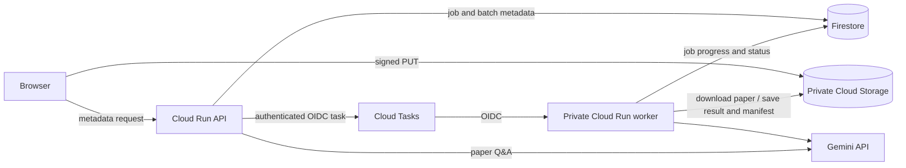

# Reacher

Reacher is my semester project. I wanted a tool that could help me review research papers and point out issues in context, but I couldn't find one that worked the way I wanted. So I decided to build it for myself.

Upload one paper or a bundle and Reacher uses Gemma 4 to identify potential issues, anchor feedback to quoted passages, suggest fixes, summarise the paper, check its references, and answer follow-up questions using relevant paper passages. It's a study aid and first-pass reviewer, not a substitute for your own judgment.

Gemma 4 is called through the **Gemini API** (Google AI Studio), so there is nothing to download and no GPU is needed.

## Setup

1. Get a free API key at https://aistudio.google.com/apikey
2. Copy `.env.example` to `.env` and paste the key:
   ```
   GEMINI_API_KEY=your_key_here
   ```
3. Install and run:
   ```bash
   python -m venv .venv
   source .venv/bin/activate        # Windows: .venv\Scripts\activate
   pip install -r requirements.txt
   python run.py
   ```

The browser opens at http://127.0.0.1:8080. The status pill (top right) turns green when the key is loaded. Hover over it if it turns red.

For local development, the port defaults to 8080 and can be changed with `PORT`. Local mode intentionally keeps the current in-process job store; it is not suitable for multiple instances or persistent production jobs.

## Models

Set `GEMMA_MODEL` in `.env`.

| Model id | Notes |
|---|---|
| `gemma-4-26b-a4b-it` (default) | faster, lighter on rate limits |
| `gemma-4-31b-it` | strongest critique |

Other settings: `MAX_NEW_TOKENS` (4096), `CHUNK_CHARS` (8000), `GEMINI_CONCURRENCY` (3 simultaneous model calls), `MAX_UPLOAD_MB` (200 per paper), `MAX_BATCH_FILES` (10), `MAX_BATCH_MB` (512 per bundle), `CROSSREF_MAILTO` (your email, for Crossref), and `PORT` (8000). Select or drop multiple PDF, DOCX, TXT, or MD files to review a bundle. Bundle reviews run one paper at a time; each paper has its own result, and a failed file does not discard successful reviews. Only one bundle can run at a time. Individual uploads are streamed to temporary files instead of being copied into application memory. Batch review results and extracted text are stored in the system temporary directory while Reacher is running and removed when it exits; individual review results remain in memory. Long-paper chunk reviews run concurrently, and each chunk now produces its factual notes and critique in one model call. The summary and cross-section check run together while citation checks overlap with model work. Large bundles may take a long time and use substantial Gemini API quota; each paper is reviewed separately. If you hit 429 rate limits, lower `GEMINI_CONCURRENCY` in `.env` to `1` or `2`; transient errors use jittered backoff, honor retry hints when possible, and cap cumulative retry delays at 60 seconds. The Gemini SDK's automatic retries are disabled so this single retry policy controls waiting. Timings for completed pipeline stages are logged.

## How it stays accurate

1. **Parsing.** PDF text is read block by block with column-aware ordering. Headers, footers and the reference list are separated from the body.
2. **Chunked review.** Long papers are split along section boundaries. Each chunk is reviewed with the abstract as context.
3. **Verbatim anchoring.** Every finding must quote the paper. The quote is located in the document text, so each flaw is highlighted in place. Findings whose quote cannot be found are hidden by default and flagged as unverified.
4. **Cross-section pass.** A separate pass compares abstract and conclusion claims against the rest of the paper, to catch overclaiming and contradictions.
5. **Deduplication, severity ranking, and a calibrated verdict** built only from the confirmed findings.
6. **Citations.** In-text markers (`[3]`, `[1–4]`, `(Smith et al., 2020)`) are matched to the reference list to find dangling and uncited entries and duplicates. Author-year citations require an exact first-author surname and year match; ambiguous same-author/year references are reported rather than silently assigned. Optional Crossref checks compare candidate title, first author, year, and any supplied DOI, ranking multiple search results instead of trusting the first hit. Only strong multi-field matches are called verified; unresolved matches and lookup failures are reported separately and are not treated as proof a source is fabricated.
7. **Paper Q&A.** Ask follow-up questions after a review. Reacher selects relevant text passages, answers from those excerpts, and links cited evidence back to its location in the paper. If it cannot find enough support, it says so rather than guessing.

## Network use

The paper text is sent to the Gemini API for analysis, so don't upload anything you are not allowed to share with Google. Paper Q&A sends your question, recent conversation context, and selected paper excerpts to Gemini. The optional Crossref lookup sends only reference strings (untick the box in the UI to disable it). In local mode, individual jobs and results are process-local and bundle results use temporary files. In Cloud Run mode, uploaded files and completed results live in a private Cloud Storage bucket and job metadata lives in Firestore.

## Limits

- Scanned PDFs need OCR first. No OCR is included.
- Upload limits default to 200 MB per paper and 10 papers / 512 MB per bundle. You can raise or lower them in `.env`, but larger files use more disk, memory, and Gemini API quota; image-only scanned PDFs still need OCR.
- The model can still miss flaws or misjudge them. Treat the output as a thorough first reviewer, not a verdict. The quote and fix are always shown so you can check each one.
- "Unverified" on a reference means no close Crossref match. Preprints, books and many conference papers are not indexed there.
- Equations, tables and figures are only seen as extracted text.
- Q&A uses keyword-based passage selection, so it may miss evidence expressed with different terminology.

## Production deployment: Google Cloud Run

Cloud Run deployment uses a separate API and worker service backed by private Cloud Storage, Firestore Native Mode, and Cloud Tasks. The API and worker use the same image and code, but deploy as separate Cloud Run services; only the API is public. Production mode is selected with `CLOUD_BACKEND=google`.



### Cloud services and cost notes

Required services are Cloud Run, Cloud Storage, Firestore Native Mode, Cloud Tasks, Secret Manager, Artifact Registry or Cloud Build, and IAM Credentials for signing uploads. The app defaults to `asia-south1`; confirm that all selected services and your chosen Gemini model are available in your project/region.

There is no minimum-instance setting. Cloud Run, Cloud Tasks, Firestore reads/writes, Cloud Storage capacity and operations, network egress, Artifact Registry, Secret Manager, and Gemini API usage can incur charges. Free quotas and regional prices change; check the current Google Cloud pricing pages and billing dashboard before enabling public access. Gemini usage is not necessarily covered by Google Cloud free tiers. A public API without user accounts can still be abused to create uploads and model charges; use Cloud Armor/API Gateway or another rate/abuse control if exposing this app beyond a small trusted audience.

Important settings are documented in `.env.example`. `GEMINI_API_KEY` is injected from Secret Manager in production; never put it in a Docker build argument or image.

| Variable | Purpose |
|---|---|
| `GEMINI_API_KEY`, `GEMMA_MODEL`, `MAX_NEW_TOKENS`, `CHUNK_CHARS` | Gemini credentials and analysis configuration |
| `MAX_UPLOAD_MB`, `MAX_BATCH_FILES`, `MAX_BATCH_MB`, `RESUMABLE_UPLOAD_THRESHOLD_MB` | Server-enforced upload limits and resumable upload threshold |
| `GEMINI_CONCURRENCY`, `CROSSREF_MAILTO`, `PORT` | Model concurrency, optional Crossref contact, and listener port |
| `CLOUD_BACKEND` | `local` for developer mode; `google` enables durable cloud processing |
| `GOOGLE_CLOUD_PROJECT`, `GOOGLE_CLOUD_STORAGE_BUCKET`, `GOOGLE_CLOUD_LOCATION` | Cloud project, private bucket, and regional deployment |
| `FIRESTORE_DATABASE` | Firestore Native Mode database name (normally `(default)`) |
| `CLOUD_TASKS_QUEUE`, `CLOUD_TASKS_LOCATION`, `CLOUD_TASKS_MAX_ATTEMPTS`, `CLOUD_TASKS_DISPATCH_DEADLINE_SECONDS` | Queue and retry/dispatch policy; queue settings must match |
| `WORKER_SERVICE_URL`, `TASK_SERVICE_ACCOUNT` | Private worker URL and Cloud Tasks OIDC identity |
| `SIGNED_URL_SERVICE_ACCOUNT` | Service account identity used to sign short-lived V4 upload URLs |
| `CORS_ALLOWED_ORIGINS` | Optional comma-separated exact origins for a separately hosted frontend |

### Google Cloud setup

The commands below use Bash syntax. Replace the project ID, bucket name, and application origin. Enable billing in the project even if you expect usage to stay within free allowances.

1. Select the project and enable the required APIs:

   ```bash
   export PROJECT_ID="your-project-id"
   export REGION="asia-south1"
   export BUCKET="${PROJECT_ID}-reacher-private"
   export API_SA="reacher-api@${PROJECT_ID}.iam.gserviceaccount.com"
   export WORKER_SA="reacher-worker@${PROJECT_ID}.iam.gserviceaccount.com"
   export TASK_SA="reacher-cloud-tasks@${PROJECT_ID}.iam.gserviceaccount.com"
   gcloud config set project "$PROJECT_ID"
   gcloud services enable run.googleapis.com storage.googleapis.com firestore.googleapis.com \
     cloudtasks.googleapis.com secretmanager.googleapis.com artifactregistry.googleapis.com \
     cloudbuild.googleapis.com iamcredentials.googleapis.com
   ```

2. Create runtime and task identities, then grant least-privilege roles. Keep API and worker identities separate. The API needs Firestore access, upload/result object access, task enqueue permission, and Secret Manager access for Q&A. The worker needs Firestore access, object access, and the Gemini secret. Grant bucket roles on the bucket rather than project-wide where possible.

   ```bash
   gcloud iam service-accounts create reacher-api
   gcloud iam service-accounts create reacher-worker
   gcloud iam service-accounts create reacher-cloud-tasks
   gcloud projects add-iam-policy-binding "$PROJECT_ID" \
     --member="serviceAccount:${API_SA}" --role="roles/datastore.user"
   gcloud projects add-iam-policy-binding "$PROJECT_ID" \
     --member="serviceAccount:${API_SA}" --role="roles/cloudtasks.enqueuer"
   gcloud projects add-iam-policy-binding "$PROJECT_ID" \
     --member="serviceAccount:${WORKER_SA}" --role="roles/datastore.user"
   ```

3. Create a private bucket with uniform bucket-level access and public access prevention, create a Firestore Native database, and create the Cloud Tasks queue. Use the same region for the bucket, Firestore, queue, and services where supported.

   ```bash
   gcloud storage buckets create "gs://${BUCKET}" --location="$REGION" \
     --uniform-bucket-level-access --public-access-prevention
   gcloud storage buckets add-iam-policy-binding "gs://${BUCKET}" \
     --member="serviceAccount:${API_SA}" --role="roles/storage.objectAdmin"
   gcloud storage buckets add-iam-policy-binding "gs://${BUCKET}" \
     --member="serviceAccount:${WORKER_SA}" --role="roles/storage.objectAdmin"
   gcloud firestore databases create --database="(default)" \
     --location="$REGION" --type=firestore-native
   gcloud tasks queues create reacher-reviews --location="$REGION" \
     --max-attempts=20 --min-backoff=5s --max-backoff=300s \
     --max-doublings=5 --max-concurrent-dispatches=10
   ```

   Files up to `RESUMABLE_UPLOAD_THRESHOLD_MB` (default 32 MB) use a 15-minute signed PUT URL. Larger files use a Cloud Storage resumable session with 8 MiB chunks and a create-only generation precondition; Google expires an unfinished session after one week. Configure bucket CORS for the exact frontend origin; do not use `*`. Example `storage-cors.json`:

   ```json
   [{"origin":["https://YOUR-API-SERVICE-URL"],"method":["PUT"],"responseHeader":["Content-Type","Content-Range","Range"],"maxAgeSeconds":1800}]
   ```

   ```bash
   gcloud storage buckets update "gs://${BUCKET}" --cors-file=storage-cors.json
   ```

4. Put the Gemini key in Secret Manager, not in an image, `.env` file, or source control. Grant `roles/secretmanager.secretAccessor` on this secret to both runtime identities. Signed URL generation with Cloud Run ADC also requires IAM Credentials API access and `roles/iam.serviceAccountTokenCreator` on the API service account for itself.

   ```bash
   gcloud secrets create GEMINI_API_KEY --replication-policy=automatic
   printf '%s' 'YOUR_GEMINI_API_KEY' | gcloud secrets versions add GEMINI_API_KEY --data-file=-
   gcloud secrets add-iam-policy-binding GEMINI_API_KEY \
     --member="serviceAccount:${API_SA}" --role="roles/secretmanager.secretAccessor"
   gcloud secrets add-iam-policy-binding GEMINI_API_KEY \
     --member="serviceAccount:${WORKER_SA}" --role="roles/secretmanager.secretAccessor"
   gcloud iam service-accounts add-iam-policy-binding "$API_SA" \
     --member="serviceAccount:${API_SA}" --role="roles/iam.serviceAccountTokenCreator"
   ```

   The API identity must be allowed to act as the task OIDC identity (`roles/iam.serviceAccountUser` on `TASK_SA`). The task identity needs `roles/run.invoker` on the worker service. The Cloud Tasks service agent must retain its Google-managed `roles/cloudtasks.serviceAgent` role.

   ```bash
   gcloud iam service-accounts add-iam-policy-binding "$TASK_SA" \
     --member="serviceAccount:${API_SA}" --role="roles/iam.serviceAccountUser"
   ```

5. Build and deploy the worker first. Deploy the worker privately and use a temporary non-empty `WORKER_SERVICE_URL` for the first deployment; fetch the actual URL and redeploy with that URL so OIDC audience verification matches it.

   ```bash
   gcloud run deploy reacher-worker --source . --region="$REGION" \
     --service-account="$WORKER_SA" --no-allow-unauthenticated \
     --timeout=2100s --concurrency=1 \
     --set-env-vars="CLOUD_BACKEND=google,GOOGLE_CLOUD_PROJECT=${PROJECT_ID},GOOGLE_CLOUD_STORAGE_BUCKET=${BUCKET},GOOGLE_CLOUD_LOCATION=${REGION},FIRESTORE_DATABASE=(default),CLOUD_TASKS_QUEUE=reacher-reviews,CLOUD_TASKS_LOCATION=${REGION},TASK_SERVICE_ACCOUNT=${TASK_SA},SIGNED_URL_SERVICE_ACCOUNT=${API_SA},WORKER_SERVICE_URL=https://placeholder.invalid" \
     --set-secrets="GEMINI_API_KEY=GEMINI_API_KEY:latest"
   export WORKER_URL="$(gcloud run services describe reacher-worker --region="$REGION" --format='value(status.url)')"
   gcloud run services update reacher-worker --region="$REGION" \
     --update-env-vars="WORKER_SERVICE_URL=${WORKER_URL}"
   gcloud run services add-iam-policy-binding reacher-worker --region="$REGION" \
     --member="serviceAccount:${TASK_SA}" --role="roles/run.invoker"
   ```

6. Deploy the public API service with the actual worker URL. There is intentionally no minimum instance count. Keep the Gemini key available to the API because paper Q&A calls Gemini directly.

   ```bash
   gcloud run deploy reacher-api --source . --region="$REGION" \
     --service-account="$API_SA" --allow-unauthenticated \
     --set-env-vars="CLOUD_BACKEND=google,GOOGLE_CLOUD_PROJECT=${PROJECT_ID},GOOGLE_CLOUD_STORAGE_BUCKET=${BUCKET},GOOGLE_CLOUD_LOCATION=${REGION},FIRESTORE_DATABASE=(default),CLOUD_TASKS_QUEUE=reacher-reviews,CLOUD_TASKS_LOCATION=${REGION},WORKER_SERVICE_URL=${WORKER_URL},TASK_SERVICE_ACCOUNT=${TASK_SA},SIGNED_URL_SERVICE_ACCOUNT=${API_SA},MAX_UPLOAD_MB=200,MAX_BATCH_FILES=10,MAX_BATCH_MB=512" \
     --set-secrets="GEMINI_API_KEY=GEMINI_API_KEY:latest"
   export API_URL="$(gcloud run services describe reacher-api --region="$REGION" --format='value(status.url)')"
   curl "${API_URL}/api/health"
   ```

   Set `GEMMA_MODEL`, `GEMINI_CONCURRENCY`, `CROSSREF_MAILTO`, and upload limits as needed. For UI/API hosted on different origins, set `CORS_ALLOWED_ORIGINS` to explicit origins and separately configure bucket CORS to allow the frontend origin. Each upload request includes a browser-generated idempotency key, so retrying the same request reuses its jobs instead of creating duplicates. The job access tokens are unguessable and required for status, result, batch, and Q&A requests; users must keep the same browser session to restore jobs after a refresh.

### Local Docker and smoke tests

```bash
docker build -t reacher:local .
docker run --rm --env-file .env -p 8080:8080 reacher:local
curl http://localhost:8080/api/health
```

Local Docker defaults to `CLOUD_BACKEND=local`, so this tests the app container and health route, not GCP integration. Cloud mode can be tested end-to-end only with an authorized development GCP project (or comprehensive service mocks); do not infer cloud deployment success from a local build.

### Deployment limitations

- Cloud Tasks dispatch deadlines are capped at 30 minutes. The worker service timeout is set slightly higher. A review that consistently exceeds the task deadline should move to Cloud Run Jobs or another workflow/orchestration mechanism; this implementation does not automatically migrate long-running jobs.
- Small uploads use short-lived signed URLs; larger uploads use resumable sessions, which allow chunk retries but act as bearer URLs until Cloud Storage expires the incomplete session after one week.
- Upload intent and job records use Firestore; results and batch manifests use Cloud Storage. Add Cloud Storage lifecycle rules and Firestore TTL policies for retention/cost control before accepting sensitive papers at scale.
- No user accounts are introduced. Bearer ownership tokens are held in browser session storage; clearing browser session storage means losing access to those job IDs.
- Cloud resources, IAM, Secret Manager, signed URL generation, Cloud Tasks, and authenticated worker dispatch must be set up and verified in a real project before production use.

## Layout

```
run.py            launcher
app/main.py       FastAPI server and job runner
app/analysis.py   review pipeline, quote grounding, dedupe
app/questions.py  paper-grounded Q&A and passage selection
app/prompts.py    all prompts
app/parse.py      PDF/DOCX/TXT reading and section chunking
app/citations.py  reference parsing, cross-checks, Crossref
app/llm.py        Gemma 4 via the Gemini API (google-genai)
static/           the UI
```
