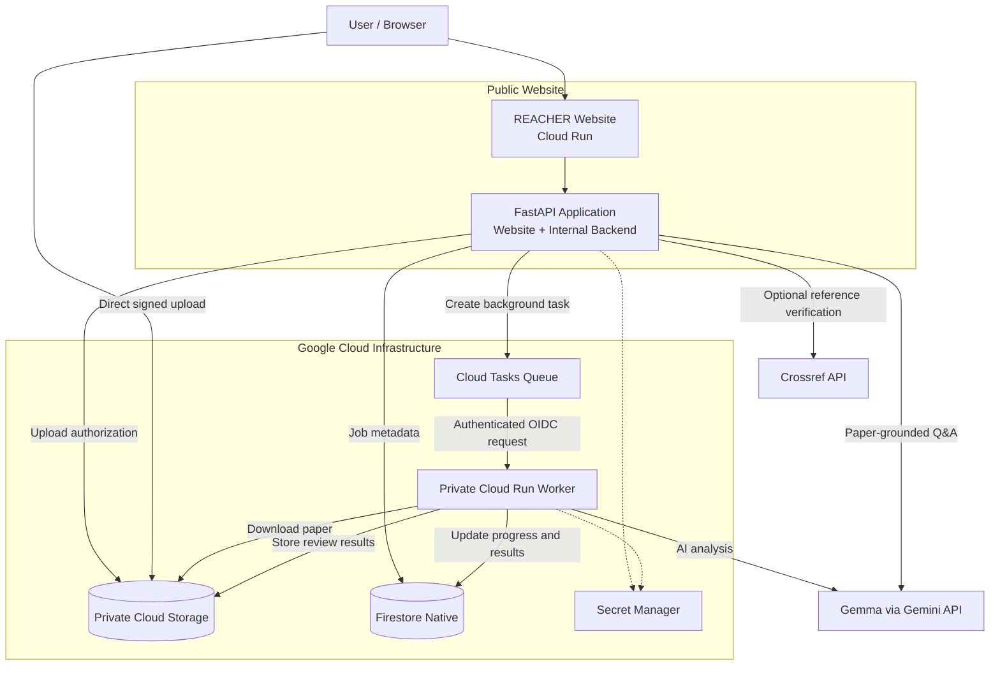

# REACHER

### AI-Assisted Research Paper Review

[Main site](https://reacher-ankit.cloud.run/)

**REACHER** is an AI-powered research paper review platform designed to help students, researchers, and academic readers examine research papers more critically.

Upload a single paper or an entire bundle of documents. REACHER analyzes arguments, methodology, evidence, claims, and references, then presents potential issues with supporting quotations from the original document.

Instead of simply generating a generic summary, REACHER aims to make feedback traceable: findings are connected to the passages that prompted them, making it easier to inspect, understand, and verify the model's suggestions.

> REACHER is a research-assistance tool, not an automated academic authority. Its findings should be reviewed and validated by a human reader.

---

## Table of Contents

- [Overview](#overview)
- [Features](#features)
- [How It Works](#how-it-works)
- [Technology Stack](#technology-stack)
- [System Architecture](#system-architecture)
- [Supported Documents](#supported-documents)
- [Getting Started](#getting-started)
- [Configuration](#configuration)
- [Google Cloud Deployment](#google-cloud-deployment)
- [Security and Privacy](#security-and-privacy)
- [Limitations](#limitations)
- [Project Structure](#project-structure)
- [Future Improvements](#future-improvements)
- [License](#license)

---

## Overview

Research papers can be difficult to evaluate thoroughly. Identifying weak arguments, methodological problems, unsupported claims, and citation inconsistencies requires more than reading a summary.

REACHER approaches this problem through a multi-stage AI-assisted review pipeline.

It uses **Gemma through the Gemini API** to analyze extracted document text and identify potential problems. The application then grounds findings in the original paper, checks references, and provides a question-answering interface for further investigation.

### What REACHER does

- Reviews research papers for potential academic and structural issues.
- Identifies weaknesses in methodology, reasoning, statistics, and claims.
- Anchors findings to quotations from the original paper.
- Highlights relevant passages for easier verification.
- Generates an overall review verdict and paper summary.
- Examines citation consistency and reference lists.
- Optionally checks references against Crossref.
- Supports follow-up questions grounded in the uploaded paper.
- Processes multiple papers as a review bundle.

---

## Features

### 1. AI-Assisted Paper Review

REACHER examines different dimensions of a research paper, including:

| Review area | What it examines |
|---|---|
| Methodology | Research design, experimental approach, and methodological gaps |
| Statistics | Statistical reasoning, interpretation, and reported results |
| Logic | Contradictions, reasoning gaps, and unsupported conclusions |
| Claims | Overgeneralization and claims exceeding the presented evidence |
| Data | Missing evidence, inconsistent reporting, and data-related concerns |
| Reproducibility | Whether the described methodology supports reproducibility |
| Citations | Citation consistency and reference-related issues |
| Ethics | Potential ethical concerns |
| Clarity | Ambiguous explanations and structural clarity |

Findings are categorized by severity:

- **Critical** — potentially fundamental problems.
- **Major** — substantial issues requiring attention.
- **Minor** — smaller concerns or opportunities for improvement.

The final review includes a calibrated recommendation, such as accept, minor revision, major revision, or reject.

These recommendations are AI-generated assessments, not actual publication decisions.

### 2. Passage-Anchored Findings

Every displayed finding is expected to include a quotation from the original document.

REACHER attempts to locate the quotation in the extracted paper text and connect it to the relevant passage.

This makes it possible to:

- Inspect the evidence behind a finding.
- Understand why the model raised a concern.
- Navigate to the relevant section.
- Verify whether the criticism is justified.

Findings whose quotations cannot be located are treated as unverified and hidden by default.

### 3. Research Paper Summary

REACHER generates a structured summary to help readers understand the paper's central contribution and content without relying exclusively on a generic abstract.

### 4. Citation and Reference Analysis

The citation analysis pipeline examines:

- In-text citations.
- Missing reference entries.
- References that are never cited.
- Potential duplicate references.
- Citation and bibliography inconsistencies.
- Author-year citation matching.
- Reference publication years and related statistics.

It supports numeric citations and author-year citation styles.

#### Optional Crossref verification

REACHER can compare extracted references with records from [Crossref](https://www.crossref.org/).

The optional online check evaluates candidate records using multiple fields, including:

- Title.
- First author.
- Publication year.
- Supplied DOI, when available.

Only strong multi-field matches are treated as verified. Unresolved matches, ambiguous references, and lookup failures are reported separately.

A reference that cannot be verified through Crossref is not automatically fabricated.

### 5. Paper-Grounded Q&A

After a review, users can ask questions about the uploaded paper.

Examples:

- What are the main limitations of this study?
- Does the conclusion follow from the experimental results?
- Which section discusses the research methodology?
- What evidence supports the authors' main claim?

REACHER selects relevant passages from the paper and sends them to Gemini as context.

Answers include evidence references that link back to the relevant passages. If sufficient supporting evidence cannot be found, REACHER is designed to abstain rather than invent an answer.

### 6. Batch Paper Review

Users can select multiple papers and submit them as a single review bundle.

Features include:

- Multiple-document upload.
- Individual review results for each paper.
- Per-paper progress and error reporting.
- Batch-level progress tracking.
- Preservation of successful results when another document fails.

Each paper is reviewed separately. A failed document does not automatically invalidate the other reviews.

### 7. Exportable Results

Completed reviews can be exported in:

- Markdown (`.md`)
- JSON (`.json`)

This makes it easier to preserve findings, share review notes, or use results in other workflows.

---

## How It Works

REACHER follows a multi-stage document analysis pipeline.

### Review pipeline

1. **Document upload** — the user selects a PDF, DOCX, TXT, or Markdown document.
2. **Document parsing** — the application extracts text and identifies document structure.
3. **Section-aware processing** — long documents are divided into manageable sections.
4. **AI analysis** — Gemma examines the paper and generates structured findings.
5. **Quote grounding** — quotations are matched against the extracted document text.
6. **Cross-section analysis** — claims in the abstract and conclusion are compared with the rest of the paper.
7. **Citation analysis** — in-text citations are matched against the reference list.
8. **Optional online verification** — Crossref is used to investigate reference matches.
9. **Result generation** — findings are deduplicated, ranked, and assembled into a review.
10. **Interactive Q&A** — users can ask additional questions using relevant paper passages.

### Document processing

PDF extraction uses PyMuPDF, including block-level reading and column-aware ordering. The parser also separates headers, footers, and reference sections where possible.

Long papers are divided along section boundaries. Each chunk is reviewed with the abstract as context.

This reduces the need to submit an entire long document in one model request.

### Accuracy and grounding

REACHER uses several safeguards to make its results easier to verify:

- Findings are checked against document quotations.
- Unlocatable quotations are not treated as verified evidence.
- Cross-section analysis looks for contradictions and overclaiming.
- Reference matching avoids silently assigning ambiguous author-year citations.
- Paper Q&A uses selected document passages rather than relying solely on general model knowledge.

These safeguards improve traceability, but they do not guarantee that every finding is correct.

---

## Technology Stack

| Component | Technology |
|---|---|
| Backend framework | Python, FastAPI |
| Frontend | HTML, CSS, JavaScript |
| AI model | Gemma |
| AI integration | Google Gemini API (`google-genai`) |
| PDF processing | PyMuPDF |
| DOCX processing | python-docx |
| Reference verification | Crossref API |
| API server | Uvicorn |
| Containerization | Docker |
| Cloud application hosting | Google Cloud Run |
| Object storage | Google Cloud Storage |
| Job metadata and status | Firestore Native Mode |
| Background task scheduling | Google Cloud Tasks |
| Secret management | Google Cloud Secret Manager |
| Container image storage | Artifact Registry |
| Container builds | Google Cloud Build |

---

## System Architecture

REACHER is designed as a website with an integrated backend and a separate background-processing worker.

The public-facing Cloud Run service serves the website and handles its internal application operations. The worker is a separate private Cloud Run service responsible for long-running paper reviews.

The application is not intended to be presented as a standalone public API product.

### Architecture diagram



### Component responsibilities

| Component | Responsibility |
|---|---|
| REACHER Website | User interface and document interaction |
| FastAPI application | Upload authorization, job management, result retrieval, and Q&A |
| Cloud Storage | Original uploads, review results, and batch manifests |
| Firestore | Job metadata, processing status, and idempotency records |
| Cloud Tasks | Reliable background task dispatch and retries |
| Cloud Run worker | Document analysis and result generation |
| Gemini API | AI-powered analysis and question answering |
| Secret Manager | Secure storage of the Gemini API key |

### Upload workflow

REACHER uses direct-to-Cloud-Storage uploads in Google Cloud mode.

1. The browser requests upload authorization.
2. The backend validates file metadata and creates job records.
3. The backend generates a short-lived signed upload URL or resumable upload session.
4. The browser uploads the document directly to the private Cloud Storage bucket.
5. The browser confirms upload completion.
6. The backend verifies the uploaded object and queues the review.
7. Cloud Tasks dispatches an authenticated request to the private worker.
8. The worker processes the document and updates job progress.
9. Results are saved to Cloud Storage, while job metadata is maintained in Firestore.
10. The website retrieves progress and results through its backend.

This design avoids routing large document uploads through the application container.

---

## Supported Documents

| Format | Extension | Support |
|---|---|---|
| PDF | `.pdf` | Supported |
| Microsoft Word | `.docx` | Supported |
| Plain text | `.txt` | Supported |
| Markdown | `.md` | Supported |

### Default upload limits

| Setting | Default |
|---|---:|
| Maximum individual paper | 200 MB |
| Maximum files per bundle | 10 |
| Maximum bundle size | 512 MB |
| Resumable upload threshold | 32 MB |

Scanned, image-only PDFs require OCR before their contents can be meaningfully analyzed. OCR is not currently included.

---

## Getting Started

REACHER can run locally without deploying the Google Cloud infrastructure.

### Prerequisites

- Python 3.10 or newer (the Docker image uses Python 3.12).
- A Gemini API key.
- Git.
- A modern web browser.

Obtain a Gemini API key from:

[Google AI Studio – API Keys](https://aistudio.google.com/apikey)

### 1. Clone the repository

```bash
git clone https://github.com/creatorhere/REACHER.git
cd REACHER
```

### 2. Create a virtual environment

**Windows PowerShell**

```powershell
python -m venv .venv
.\.venv\Scripts\Activate.ps1
```

**Linux / macOS**

```bash
python3 -m venv .venv
source .venv/bin/activate
```

### 3. Install dependencies

```bash
python -m pip install --upgrade pip
pip install -r requirements.txt
```

### 4. Configure environment variables

Copy the example configuration.

**Windows PowerShell**

```powershell
Copy-Item .env.example .env
```

**Linux / macOS**

```bash
cp .env.example .env
```

Open `.env` and configure your Gemini API key:

```env
GEMINI_API_KEY=your_gemini_api_key

GEMMA_MODEL=gemma-4-26b-a4b-it

MAX_NEW_TOKENS=4096
CHUNK_CHARS=8000
GEMINI_CONCURRENCY=3

MAX_UPLOAD_MB=200
MAX_BATCH_FILES=10
MAX_BATCH_MB=512

RESUMABLE_UPLOAD_THRESHOLD_MB=32
CROSSREF_MAILTO=
PORT=8080

CLOUD_BACKEND=local
```

Keep the remaining Google Cloud settings empty for local development.

### 5. Run REACHER

```bash
python run.py
```

Open:

```text
http://127.0.0.1:8080
```

The local launcher attempts to open the browser automatically.

The model status indicator in the interface reports whether the Gemini API client is ready.

---

## Configuration

The application is configured through environment variables.

### AI configuration

| Variable | Default | Description |
|---|---|---|
| `GEMINI_API_KEY` | Empty | Gemini API key |
| `GEMMA_MODEL` | `gemma-4-26b-a4b-it` | Model identifier |
| `MAX_NEW_TOKENS` | `4096` | Maximum generated output tokens |
| `CHUNK_CHARS` | `8000` | Target document chunk size |
| `GEMINI_CONCURRENCY` | `3` | Maximum simultaneous model calls |
| `CROSSREF_MAILTO` | Empty | Optional contact email for Crossref requests |

### Upload configuration

| Variable | Default | Description |
|---|---:|---|
| `MAX_UPLOAD_MB` | `200` | Maximum individual file size |
| `MAX_BATCH_FILES` | `10` | Maximum files in a bundle |
| `MAX_BATCH_MB` | `512` | Maximum combined bundle size |
| `RESUMABLE_UPLOAD_THRESHOLD_MB` | `32` | Threshold for resumable uploads |
| `PORT` | `8080` | Application listening port |

### Google Cloud configuration

| Variable | Description |
|---|---|
| `CLOUD_BACKEND` | Selects `local` or `google` mode |
| `GOOGLE_CLOUD_PROJECT` | Google Cloud project ID |
| `GOOGLE_CLOUD_STORAGE_BUCKET` | Private upload and result bucket |
| `GOOGLE_CLOUD_LOCATION` | Cloud resource region |
| `FIRESTORE_DATABASE` | Firestore database name |
| `CLOUD_TASKS_QUEUE` | Background processing queue |
| `CLOUD_TASKS_LOCATION` | Cloud Tasks queue region |
| `CLOUD_TASKS_DISPATCH_DEADLINE_SECONDS` | Maximum task dispatch deadline |
| `CLOUD_TASKS_MAX_ATTEMPTS` | Maximum task retry attempts |
| `WORKER_SERVICE_URL` | Private Cloud Run worker URL |
| `TASK_SERVICE_ACCOUNT` | Service account used for task OIDC authentication |
| `SIGNED_URL_SERVICE_ACCOUNT` | Service account used for signed upload URLs |
| `CORS_ALLOWED_ORIGINS` | Optional comma-separated list of allowed browser origins |

See `.env.example` for the complete configuration template.

---

## Google Cloud Deployment

REACHER supports a production-oriented deployment on Google Cloud.

The deployment uses:

- Cloud Run for the public website and private worker.
- Cloud Storage for document uploads and review results.
- Firestore Native Mode for job metadata.
- Cloud Tasks for asynchronous processing.
- Secret Manager for the Gemini API key.
- Artifact Registry for container images.
- Cloud Build for source-based container builds.

### Deployment layout

| Service | Cloud Run service | Access |
|---|---|---|
| Website and application backend | `reacher` | Public |
| Background processing worker | `reacher-worker` | Private |

Both services use the same application image but have different service accounts and runtime responsibilities.

The public website handles browser requests and internal backend operations. The private worker handles long-running document reviews.

### Required Google Cloud APIs

Enable the following APIs in your project:

```bash
gcloud services enable \
  run.googleapis.com \
  storage.googleapis.com \
  firestore.googleapis.com \
  cloudtasks.googleapis.com \
  secretmanager.googleapis.com \
  artifactregistry.googleapis.com \
  cloudbuild.googleapis.com \
  iamcredentials.googleapis.com
```

### Example deployment configuration

The following commands illustrate the deployment structure. Replace project-specific values with your own configuration and ensure the required IAM permissions and resources exist first.

```bash
export PROJECT_ID="your-project-id"
export REGION="asia-south1"
export BUCKET="${PROJECT_ID}-reacher-private"

export API_SA="reacher-api@${PROJECT_ID}.iam.gserviceaccount.com"
export WORKER_SA="reacher-worker@${PROJECT_ID}.iam.gserviceaccount.com"
export TASK_SA="reacher-cloud-tasks@${PROJECT_ID}.iam.gserviceaccount.com"

gcloud config set project "$PROJECT_ID"
```

### Deploy the private worker

Build and deploy the worker first.

```bash
gcloud run deploy reacher-worker \
  --source . \
  --region="$REGION" \
  --service-account="$WORKER_SA" \
  --no-allow-unauthenticated \
  --timeout=2100s \
  --concurrency=1 \
  --set-env-vars="CLOUD_BACKEND=google,GOOGLE_CLOUD_PROJECT=${PROJECT_ID},GOOGLE_CLOUD_STORAGE_BUCKET=${BUCKET},GOOGLE_CLOUD_LOCATION=${REGION},FIRESTORE_DATABASE=(default),CLOUD_TASKS_QUEUE=reacher-reviews,CLOUD_TASKS_LOCATION=${REGION},TASK_SERVICE_ACCOUNT=${TASK_SA},SIGNED_URL_SERVICE_ACCOUNT=${API_SA},WORKER_SERVICE_URL=https://placeholder.invalid" \
  --set-secrets="GEMINI_API_KEY=GEMINI_API_KEY:latest"
```

Retrieve the worker URL:

```bash
export WORKER_URL="$(gcloud run services describe reacher-worker \
  --region="$REGION" \
  --format='value(status.url)')"
```

Update the worker with its actual URL:

```bash
gcloud run services update reacher-worker \
  --region="$REGION" \
  --update-env-vars="WORKER_SERVICE_URL=${WORKER_URL}"
```

Allow Cloud Tasks to invoke the worker:

```bash
gcloud run services add-iam-policy-binding reacher-worker \
  --region="$REGION" \
  --member="serviceAccount:${TASK_SA}" \
  --role="roles/run.invoker"
```

### Deploy the public website

Deploy the application as the public-facing REACHER website:

```bash
gcloud run deploy reacher \
  --source . \
  --region="$REGION" \
  --service-account="$API_SA" \
  --allow-unauthenticated \
  --set-env-vars="CLOUD_BACKEND=google,GOOGLE_CLOUD_PROJECT=${PROJECT_ID},GOOGLE_CLOUD_STORAGE_BUCKET=${BUCKET},GOOGLE_CLOUD_LOCATION=${REGION},FIRESTORE_DATABASE=(default),CLOUD_TASKS_QUEUE=reacher-reviews,CLOUD_TASKS_LOCATION=${REGION},WORKER_SERVICE_URL=${WORKER_URL},TASK_SERVICE_ACCOUNT=${TASK_SA},SIGNED_URL_SERVICE_ACCOUNT=${API_SA},MAX_UPLOAD_MB=200,MAX_BATCH_FILES=10,MAX_BATCH_MB=512" \
  --set-secrets="GEMINI_API_KEY=GEMINI_API_KEY:latest"
```

Retrieve the website URL:

```bash
export REACHER_URL="$(gcloud run services describe reacher \
  --region="$REGION" \
  --format='value(status.url)')"

echo "$REACHER_URL"
```

Test the application:

```bash
curl "${REACHER_URL}/api/health"
```

Open the returned website URL in a browser.

### Storage CORS

The browser uploads documents directly to Cloud Storage, so the private bucket must allow the website's origin for the required upload methods.

Create a CORS configuration using the actual website URL:

```bash
cat > storage-cors.json <<EOF
[
  {
    "origin": ["${REACHER_URL}"],
    "method": ["PUT"],
    "responseHeader": ["Content-Type", "Content-Range", "Range"],
    "maxAgeSeconds": 1800
  }
]
EOF
```

Apply it:

```bash
gcloud storage buckets update \
  "gs://${BUCKET}" \
  --cors-file=storage-cors.json
```

Use the exact website origin. Do not use a wildcard origin for production uploads.

### Custom website URL

A Cloud Run custom URL can be configured separately from the default service URL.

For example, the intended REACHER address is:

```text
https://reacher-ankit.cloud.run
```

The custom URL must be successfully claimed and mapped to the `reacher` website service before it can be treated as the production address.

---

## Security and Privacy

REACHER processes research documents that may contain unpublished or confidential material. Users should understand how document content is handled before uploading.

### Document processing

In Google Cloud mode:

- Uploaded files are stored in a private Cloud Storage bucket.
- Job metadata is stored in Firestore.
- Completed review results are stored in Cloud Storage.
- The worker accesses storage through its assigned service account.
- The Gemini API key is supplied through Secret Manager.
- Cloud Tasks invokes the private worker using authenticated OIDC requests.

### AI processing

Paper text is sent to the Gemini API for analysis.

Paper Q&A sends the user's question, recent conversation context, and selected paper passages to Gemini.

Optional Crossref verification sends reference strings to Crossref. This can be disabled in the interface.

Do not upload documents unless you are authorized to share their contents with the relevant external services.

### Access control

The application does not currently introduce user accounts or a conventional login system.

Instead, cloud-mode jobs use unguessable bearer access tokens. These tokens are held in browser session storage and are required for access to the corresponding job, batch, result, and Q&A operations.

Clearing the browser session can mean losing access to previously created jobs.

The public website is unauthenticated at the Cloud Run service level. This does not mean the application is protected against abuse. Before opening the application to a broad audience, implement appropriate rate limiting, abuse prevention, and user access controls.

### Secret management

Never commit real API keys, service-account credentials, or `.env` files to GitHub.

Use Secret Manager for production credentials.

---

## Limitations

REACHER is an evolving project. The following limitations are important:

- Scanned PDFs require OCR, which is not currently implemented.
- Tables, equations, and figures are primarily analyzed through extracted text.
- AI-generated findings may be incorrect or incomplete.
- Citation verification depends on the coverage and quality of Crossref records.
- Some legitimate publications may not have a strong Crossref match.
- Paper Q&A uses keyword-based passage retrieval and may miss relevant passages expressed with different terminology.
- Very large documents and bundles can take considerable time and consume significant model quota.
- Local mode uses in-process job storage and is not designed for multi-instance production deployment.
- Cloud Tasks dispatch deadlines are limited to 30 minutes in the current implementation.
- Long-running reviews may require additional orchestration if they exceed the task deadline.

REACHER should be treated as a first-pass reviewer and research companion, not as a replacement for academic judgment, peer review, or professional editorial review.

---

## Cost Considerations

Google Cloud and Gemini API usage may incur charges.

Potential cost sources include:

- Cloud Run CPU and memory usage.
- Cloud Build and Artifact Registry.
- Cloud Storage capacity and operations.
- Firestore reads and writes.
- Cloud Tasks operations.
- Secret Manager.
- Network traffic.
- Gemini API requests and generated tokens.
- Optional external reference verification.

Free tiers, quotas, and regional pricing can change. Check the current pricing and billing dashboard before running the application at scale.

For cost control, consider:

- Keeping Cloud Run minimum instances at zero where practical.
- Limiting upload sizes and bundle sizes.
- Monitoring Gemini API consumption.
- Reducing `GEMINI_CONCURRENCY` if quota pressure occurs.
- Configuring retention policies for stored uploads and results.
- Setting billing alerts.

---

## Project Structure

```text
REACHER/
│
├── app/
│   ├── main.py              # FastAPI application and route handling
│   ├── cloud.py             # Google Cloud storage, tasks and job processing
│   ├── analysis.py          # Review pipeline and finding validation
│   ├── questions.py         # Paper-grounded Q&A and passage retrieval
│   ├── prompts.py           # AI prompts and structured instructions
│   ├── parse.py             # Document extraction and section parsing
│   ├── citations.py         # Reference parsing and verification
│   ├── llm.py               # Gemini API integration
│   ├── config.py            # Environment and application configuration
│   └── logging_config.py    # Application logging configuration
│
├── static/
│   ├── index.html           # Website interface
│   ├── style.css            # Application styling
│   └── app.js               # Frontend interactions and API requests
│
├── .env.example             # Environment configuration template
├── .gitignore
├── Dockerfile               # Container configuration
├── requirements.txt         # Python dependencies
├── run.py                   # Local application launcher
└── README.md
```

---

## Future Improvements

Potential areas for further development include:

- User accounts and secure authentication.
- Persistent user review history and document management.
- OCR support for scanned documents.
- More advanced semantic retrieval for paper Q&A.
- Improved mathematical and table understanding.
- More detailed methodology and statistical checks.
- Additional reference databases and DOI verification.
- Downloadable PDF review reports.
- Review comparison across multiple versions of a paper.
- Configurable document retention and deletion.
- Rate limiting and abuse prevention.
- Improved monitoring and observability for background jobs.

---

## License

No license has been specified yet.

Until a license is added to the repository, the project's reuse and redistribution terms should not be assumed to be open source.

---

## Project

**REACHER — Research deserves a closer read.**

Built as an exploration of AI-assisted academic review, document processing, and cloud-based application architecture.
